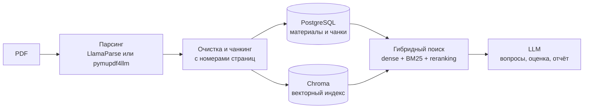

# Verba AI

Тренажёр для подготовки к устным экзаменам. Студент загружает свой конспект или учебник в PDF, система задаёт вопросы по этому материалу, оценивает ответы и показывает, на какие страницы источника стоит вернуться.

> **Статус:** MVP. Работают регистрация, загрузка материалов, тренировочные сессии, история, итоговый отчёт и тестовые платежи через ЮKassa.

## Как это работает

1. Пользователь загружает PDF до 50 МБ.
2. Текст извлекается, очищается и делится на фрагменты (чанки). У каждого фрагмента сохраняются номера страниц и заголовок раздела.
3. Фрагменты индексируются для поиска.
4. LLM составляет вопросы по разным частям документа, вместе с эталонными тезисами и ссылками на страницы.
5. На каждый ответ система заново находит релевантный контекст в материале и оценивает ответ по нему, а не «по памяти» модели.
6. После последнего вопроса формируется отчёт: общий балл, разбор по темам (сильные и слабые), страницы для повторения и рекомендации.



## Что внутри

**Обработка PDF.** Если задан ключ LlamaParse, используется он, иначе локальный `pymupdf4llm`. Текст нормализуется, слова, разорванные переносом, склеиваются. Чанки строятся по заголовкам, абзацам и предложениям с перекрытием, большие таблицы делятся по строкам с повторением шапки.

**Поиск (RAG).** Семантический поиск на эмбеддингах `paraphrase-multilingual-MiniLM-L12-v2` (FastEmbed) объединяется с BM25, затем результаты переранжируются по совпадению терминов и ожидаемым страницам. Фрагменты ниже порога релевантности в оценку не попадают. Если векторный индекс недоступен, поиск продолжает работать на BM25.

**Надёжность индексации.** Материал получает статус «готов», только когда он записан и в PostgreSQL, и в Chroma. При ошибке частичная запись откатывается.

**LLM-провайдеры.** Логика собеседования работает через интерфейс `InterviewLLMProvider`. Сейчас есть два провайдера: `codex_cli` для реальной генерации и оценки со строгой JSON Schema и `mock` для автотестов и демо без LLM. Подключить API другой модели можно новым классом, не меняя API, RAG и интерфейс.

**Доступ и тарифы.** Авторизация по JWT, пользователь видит только свои материалы и сессии. Есть бесплатный тариф с лимитом сессий и Pro-тариф с оплатой через ЮKassa (тестовый магазин, вебхук подтверждения).

## Стек

| Область | Технологии |
| --- | --- |
| Клиент | Next.js 15, React 19, TypeScript, Tailwind CSS, Zustand |
| API | Python 3.12, FastAPI, SQLAlchemy (async), Pydantic, JWT |
| Данные | PostgreSQL 16, Chroma |
| RAG | pymupdf4llm, LlamaParse, FastEmbed, BM25 |
| Платежи | ЮKassa |
| Инфраструктура | Docker Compose |
| Тесты | Pytest, ESLint |

## Структура репозитория

```text
backend/    FastAPI-приложение: API, модели, сервисы RAG, LLM и оплаты, тесты
frontend/   Next.js-клиент: лендинг, личный кабинет, материалы, тренировка, отчёт
docs/       документация по RAG, модулю собеседования и этапам проекта
```

## Быстрый старт

Нужен Docker с Docker Compose.

```bash
cp .env.example .env
docker compose up -d --build
```

| Сервис | Адрес |
| --- | --- |
| Веб-интерфейс | http://localhost:3000 |
| API | http://localhost:8000/api/v1 |
| Swagger (OpenAPI) | http://localhost:8000/docs |

По умолчанию запускается демо-режим `mock`: приложение работает целиком, но вопросы и оценки генерируются заглушкой, а не LLM. Для реального режима укажите в `.env`:

```env
INTERVIEW_LLM_PROVIDER=codex_cli
CODEX_CLI_PATH=codex
CODEX_INTERVIEW_MODEL=gpt-5.4-mini
```

На машине с backend должен быть установлен и авторизован Codex CLI (`codex login`). Остальные переменные описаны в [.env.example](.env.example).

Остановить сервисы: `docker compose down`. Удалить вместе с данными: `docker compose down -v`.

## Тесты и качество поиска

```bash
# backend
cd backend
python3.12 -m venv .venv
.venv/bin/pip install -r requirements.txt
PYTHONPATH=. .venv/bin/pytest -q

# оценка качества RAG на контрольном наборе
PYTHONPATH=. .venv/bin/python scripts/evaluate_rag.py

# frontend
cd frontend
npm ci
npm run lint
npm run build
```

Тесты покрывают загрузку материалов и откат при ошибке индексации, создание платежа, полный цикл собеседования, чанкинг и LLM-провайдеры. Качество поиска измеряется на наборе `backend/benchmarks/rag_quality_dataset.json` метриками Recall@3, MRR и Top-1 accuracy.

## Документация

- [RAG-контур](docs/RAG.md): обработка PDF, индексация, поиск и метрики.
- [Тренировочное собеседование](docs/INTERVIEW.md): провайдеры, сценарий и состояния сессии.
- [Этап 1](docs/stage-1/README.md): архитектура, план и программа испытаний MVP.

## Автор

Михаил Заметаев, [GitHub](https://github.com/qwers451) · Telegram [@qwers451](https://t.me/qwers451)
